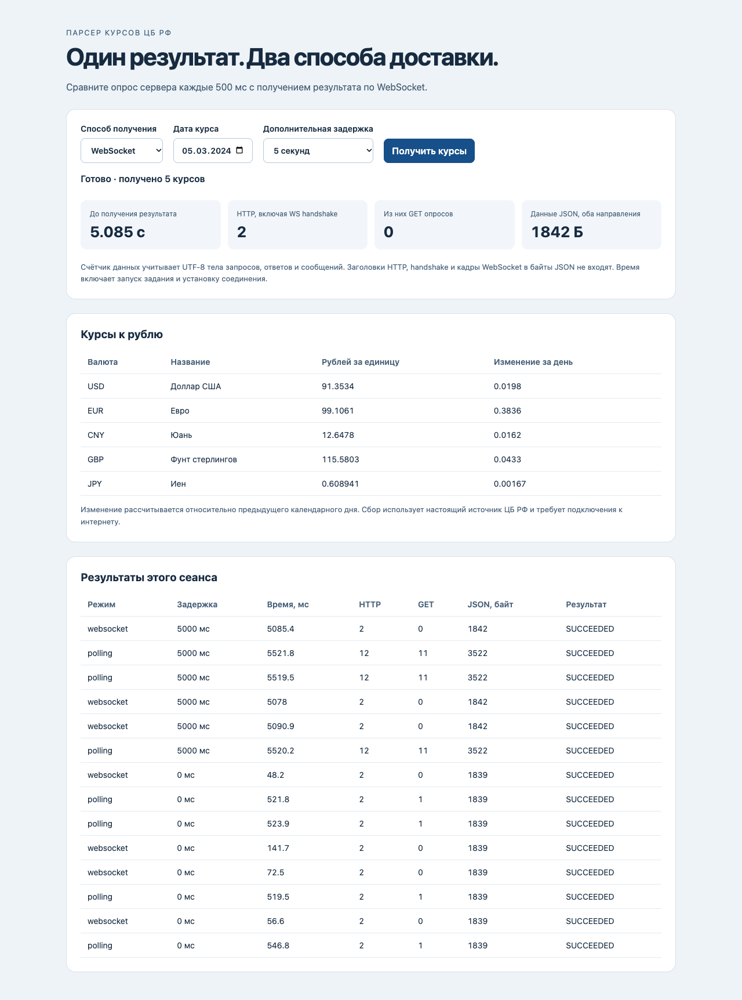

# Сравнение REST polling и WebSocket

## Реализация

В парсер курсов ЦБ РФ добавлен [index.html](../src/main/resources/static/index.html) без фреймворков. Страница запускает сбор пяти валют за выбранную дату, показывает курсы и сохраняет результаты сравнения за текущий сеанс. Дополнительная задержка обработки выбирается в интерфейсе: 0 или 5 секунд.

Оба режима начинают операцию через `POST /api/jobs` и получают HTTP 202 с идентификатором задания:

- **REST polling:** каждые 500 мс выполняется `GET /api/jobs/{id}`. Готовый ответ содержит курсы; после получения результата опрос прекращается. Медленные GET не перекрываются.
- **WebSocket:** открывается `/ws/jobs/{id}`. Сервер отправляет одно сообщение с результатом сразу после завершения сбора, затем закрывает соединение. Если задание завершилось до подключения, сохранённый результат отправляется при подключении.

Результаты привязаны к отдельным заданиям; ошибки обработки также доставляются обоими способами. Прежние `/api/collect` и `/answer` сохранены. [Запуск проекта и воспроизведение замеров](../readme.md#rest-polling-и-websocket--тема-5).

## Метод измерения

Использованы Java 17.0.19, Spring Boot 3.5.16, браузер Yandex 26.11.0.0, DevTools через CDP и Playwright 1.65.1. Приложение и браузер работали локально на macOS ARM64; heap приложения — 128–256 МиБ. Каждый сбор обращался к настоящему XML-сервису ЦБ за 05.03.2024 и 04.03.2024. Периодический автосбор на время измерений отключён.

Выполнены два прогрева, затем по три операции для каждой комбинации режима и задержки; порядок режимов чередовался. В таблице приведены медианы, прогрев исключён. Время измерено через `performance.now()` от запуска операции во фронтенде до получения и разбора готового ответа, включая POST и установку WebSocket.

Количество HTTP-запросов сверено с событиями DevTools. **JSON** — сумма UTF-8 тел запросов, ответов и сообщений в обоих направлениях. **Обмен HTTP/WS** — байты, реально прошедшие через локальное TCP-реле: заголовки HTTP, тела, chunk framing, WebSocket handshake и кадры, включая закрытие. Загрузка страницы, обращения сервера к ЦБ и заголовки TCP/IP не входят. HTTP-сжатие и WebSocket permessage-deflate отключены; это проверено по заголовкам ответов.

## Результаты

| Задержка | Режим | HTTP-запросов | GET опросов | Время, мс | JSON, байт | Обмен HTTP/WS, байт |
|---|---|---:|---:|---:|---:|---:|
| 0 с | Polling | 2 | 1 | 521,8 | 1 839 | 3 630 |
| 0 с | WebSocket | 2 | 0 | 72,5 | 1 839 | 3 518 |
| 5 с | Polling | 12 | 11 | 5 520,2 | 3 522 | 13 733 |
| 5 с | WebSocket | 2 | 0 | 5 085,4 | 1 842 | 3 521 |

В WebSocket-режиме два HTTP-запроса — это POST запуска и GET handshake с ответом 101. Сам результат приходит отдельным WebSocket-сообщением и не является новым HTTP-запросом.

Без задержки время polling составило 519,5–523,9 мс, WebSocket — 48,2–141,7 мс. При задержке 5 секунд: 5 519,5–5 521,8 мс и 5 078,0–5 090,9 мс соответственно. Разброс включает время обращения к внешнему ЦБ.

Все **12 измеряемых операций завершились успешно**, значения пяти курсов совпали. Пройдены **40 автоматических тестов**, в том числе доставка уже готового результата, передача ошибки, ограничение очереди и отклонение чужого WebSocket origin. В браузере также проверено восстановление управления после HTTP-ошибки.

[Исходные измерения и события DevTools](../results/delivery/measurements.json), [сводка](../results/delivery/summary.json), [проверки браузера](../results/delivery/browser-checks.json), [результаты тестов](../results/delivery/tests.json).

## Вывод

Polling добавляет ожидание следующего опроса: в режиме с задержкой 5 секунд медиана оказалась на 434,8 мс больше, чем у WebSocket. За эту операцию polling создал 12 HTTP-запросов против двух и передал примерно в 3,9 раза больше байт HTTP/WS. Для долгих операций WebSocket сокращает повторные запросы, но требует поддержки соединений и обработки обрывов; для редких коротких операций polling проще. Эти замеры сравнивают доставку одному клиенту, а не предел масштабируемости: для нескольких экземпляров потребуется общее хранилище заданий и доставка событий между экземплярами.
